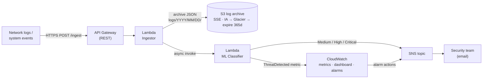
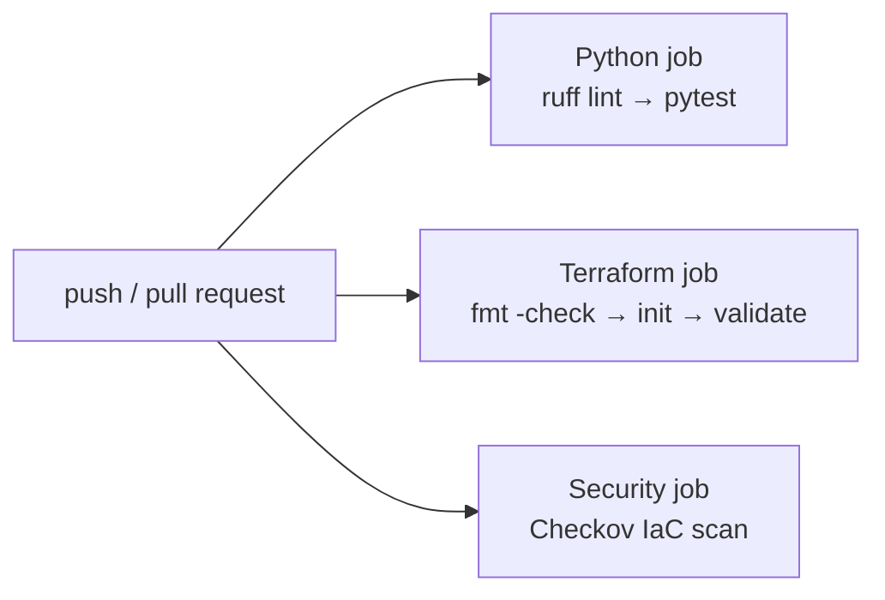

# 🔐 Serverless Security Threat Detection Platform on AWS

[](https://github.com/chaithanyareddyk3273/aws-serverless-security-threat-detection/actions/workflows/ci.yml)


A serverless pipeline that ingests network log events over HTTPS, classifies them with a scikit-learn model, and alerts the security team through SNS with a step-by-step remediation playbook. All infrastructure is defined in Terraform and checked by a GitHub Actions pipeline on every push.

---

## 🏗️ Architecture



**Request flow**

1. A client `POST`s a log event to `/ingest`. The **ingestor** Lambda tags it with an event ID and timestamp, archives it to S3 (partitioned by date), and invokes the classifier asynchronously, returning `202 Accepted` immediately.
2. The **classifier** Lambda validates the event, extracts a 16-feature vector, and runs the Random Forest model (loaded once per warm container).
3. Each detected threat publishes a `ThreatDetected` metric to CloudWatch. Threats of Medium severity or higher also publish an SNS alert containing the threat type, confidence, source IP and remediation steps.
4. Two CloudWatch alarms add a second layer: any **Critical** threat, or **10+ threats in 5 minutes** (a possible attack wave).

---

## 🔄 CI/CD pipeline



Defined in [`.github/workflows/ci.yml`](.github/workflows/ci.yml); the three jobs run in parallel:

| Job | What it checks |
|---|---|
| **Python** | `ruff` lint for real errors, then the `pytest` suite: feature extraction, validation, the threat taxonomy, and the classifier Lambda's metrics and alerting (with AWS mocked) |
| **Terraform** | `terraform fmt -check`, then `init -backend=false` and `validate`, so no AWS credentials are needed in CI |
| **Security** | [Checkov](https://www.checkov.io/) scans the Terraform for misconfigurations. It runs in report-only mode for now (see the roadmap). |

---

## 🛠️ Tech stack

| Layer | Technology |
|---|---|
| Compute | AWS Lambda (Python 3.11) |
| API | Amazon API Gateway (REST) |
| Storage | Amazon S3: server-side encryption, lifecycle tiering to IA and Glacier |
| Alerting | Amazon SNS (email subscription) |
| Observability | Amazon CloudWatch: custom metrics, dashboard, alarms, 30-day log retention |
| ML | scikit-learn Random Forest trained on the KDD Cup 99 intrusion dataset |
| IaC | Terraform (AWS provider ~> 5.0) |
| CI | GitHub Actions: ruff, pytest, Terraform fmt/validate, Checkov |

---

## 🧪 Threat categories

| Threat | Severity | Example pattern | Alert? |
|---|---|---|---|
| DoS / DDoS | Critical | SYN flood, very high connection rate | ✅ |
| Data exfiltration | Critical | Large outbound data burst | ✅ |
| Brute force | High | Repeated failed logins | ✅ |
| Phishing | High | Suspicious outbound DNS and payload | ✅ |
| Port scan | Medium | Sequential port probes from one IP | ✅ |
| Normal | Info | Baseline traffic | — |

Every alert includes a remediation playbook from [`classifier/threat_types.py`](classifier/threat_types.py), for example: block the source IP in security groups/WAF, check CloudTrail, rotate credentials.

---

## 📁 Project structure

```
.
├── .github/workflows/ci.yml   # CI: lint, tests, Terraform checks, Checkov
├── classifier/
│   ├── train.py               # Train the Random Forest on KDD Cup 99
│   ├── model.py               # Model wrapper (singleton, loads once per container)
│   ├── features.py            # Raw event → 16-feature vector + validation
│   └── threat_types.py        # Severity mapping + remediation playbooks
├── lambda/
│   ├── ingestor/handler.py    # API Gateway → S3 archive → async classifier invoke
│   └── classifier/handler.py  # Inference → CloudWatch metrics → SNS alerts
├── terraform/
│   ├── main.tf                # Provider, S3, API Gateway, IAM, outputs
│   ├── lambda.tf              # Lambda functions + log groups
│   ├── sns_cloudwatch.tf      # SNS topic, dashboard, alarms
│   └── variables.tf
├── tests/
│   ├── test_classifier.py           # Features, validation, taxonomy
│   ├── test_classifier_handler.py   # Metrics + alerting (AWS mocked)
│   └── sample_event.json            # Example event for the deployed API
├── requirements.txt
└── ruff.toml
```

---

## 🚀 Run it

**Tests (no AWS account needed)**

```bash
pip install -r requirements.txt
pytest -v
```

**Train the model.** Download `kddcup.data_10_percent.gz` from the [KDD Cup 99 page](http://kdd.ics.uci.edu/databases/kddcup99/kddcup99.html) into `data/`, then run:

```bash
python classifier/train.py   # writes classifier/model_artifacts/
```

**Deploy**

1. Set your state bucket in the `backend "s3"` block in `terraform/main.tf`.
2. Build `lambda/ingestor/package.zip` and `lambda/classifier/package.zip`. The classifier package needs the `classifier/` package, the model artifacts, and scikit-learn/numpy; provide those as a Lambda layer or container image, since they exceed the direct-upload size limit.
3. Apply:

```bash
cd terraform
terraform init
terraform apply -var="alert_email=you@example.com"
```

4. Send a test event:

```bash
curl -X POST "$(terraform output -raw api_endpoint)" \
  -H "Content-Type: application/json" \
  -d @../tests/sample_event.json
```

---

## 🗺️ Known limitations & roadmap

- [ ] **Align training and inference features.** `train.py` trains on 16 KDD columns, while `features.py` builds a different 16-feature vector from live events. The shapes match, but the features don't, so predictions aren't meaningful until a shared feature schema is used for both.
- [ ] **Packaging and deployment in CI.** Build the Lambda artifacts (layer or container image) and add a `terraform plan` / `apply` job using GitHub OIDC → IAM role, with no long-lived keys.
- [ ] **Secure the ingest API.** `/ingest` currently uses `authorization = "NONE"`. Add IAM auth or an API key, a usage plan, and AWS WAF rate limiting.
- [ ] **Harden S3.** Add a public-access block, versioning, and KMS encryption; then switch Checkov from report-only to blocking.
- [ ] **Slack alerts.** Add a Lambda or AWS Chatbot subscription on the SNS topic.

---

## 📄 License

MIT
